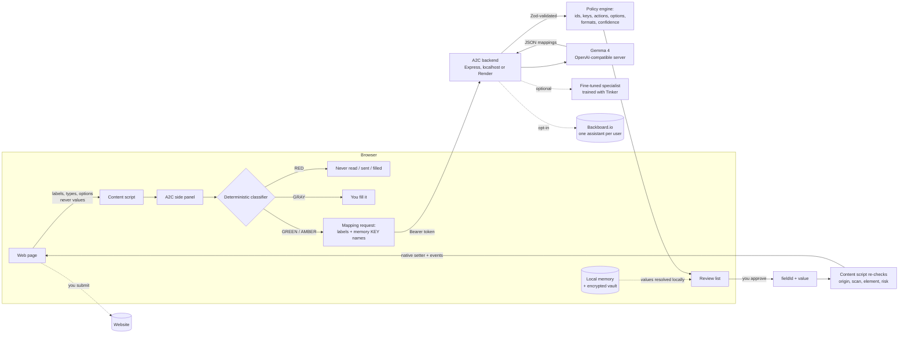

# A2C: AI to Completion

**Your memory. Any form. Automatically completed.**

A2C is a privacy-first Chrome extension that fills web forms and document templates from information you have approved. **Gemma 4** works out what each question is asking and which of your saved facts answers it. Your values stay on your device. Sensitive fields need your approval, and credentials are never touched. You review the answers and submit the form yourself.

Sponsor tech: **Gemma 4** (primary AI), **Backboard.io** (opt-in cloud memory), **Render** (backend hosting), **Tinker** (fine-tuning experiment).

---

## Status: what is implemented, configured and verified

| Feature | State | Evidence |
| --- | --- | --- |
| MV3 extension: side panel, on-demand content script, pixel UI | ✅ Working | Production build; driven in Chromium via Playwright |
| Local profile, permissions (Automatic candidate / Approval required / Never collect), provenance | ✅ Working | Real-browser run + unit tests |
| Encrypted vault for private facts (PBKDF2 600k + AES-GCM) | ✅ Working | Unit tests (round trip, wrong passphrase, no plaintext, fresh IV) |
| Form scanning (labels, ARIA, fieldsets, selects, radio/checkbox groups, open shadow DOM, dynamic fields) | ✅ Working | jsdom tests + Chromium run |
| Deterministic RED/AMBER/GRAY/GREEN classifier before any AI call | ✅ Working | 50+ tests, adversarial demo |
| **Gemma 4 E4B** inference (`hf.co/google/gemma-4-E4B-it-qat-q4_0-gguf` on Ollama) | ✅ **Verified on the dev machine** | Live completion; zero-shot evaluation below |
| Review, approval, editing, overwrite protection, completion summary | ✅ Working | Chromium run + tests |
| Safe autofill (native setters, input/change events, React-controlled inputs, selects, radios, checkbox groups); never submits | ✅ Working | React 19 test + no-submit test + Chromium run |
| Missing info → Use once / Save to memory (consent + extra confirmation) | ✅ Working | Chromium run + tests |
| Backend auth (per-user bearer tokens), per-user rate limits, startup guard | ✅ Implemented + tested | `tests/backend.test.ts` |
| **Backboard.io** cloud memory (opt-in save, list, read-only search, delete, one assistant per user) | ⚙️ Implemented, tested against a mocked Backboard API | **Not run against a live Backboard account** (no API key available) |
| **Render** deployment (`render.yaml`, 0.0.0.0/PORT, health check, CORS origin) | ⚙️ Configured | **Not deployed** from this machine |
| **Tinker** dataset, SFT script, evaluation, comparison | ⚙️ Scripts + tests run; baseline and Gemma evaluated | **No fine-tuning run yet** (no `TINKER_API_KEY`) |
| DOCX `{{placeholders}}` and fillable PDF (AcroForm) | ✅ Working | Tests on demo files + Chromium run |

Not supported: iframes, closed shadow roots, div-based custom widgets, multi-select lists, scanned or encrypted PDFs, PDF checkboxes and signatures, blank lines in Word documents.

---

## Architecture



| Path | What it is |
| --- | --- |
| `apps/extension` | MV3 extension (React 19, TypeScript, Vite 8, Tailwind 4, Lucide, Zod). Side panel tabs: Autofill, Memory, Templates, Privacy, Settings |
| `apps/server` | Express 5 backend: auth, rate limits, Gemma adapter (retries, JSON mode), Backboard client, specialist route |
| `packages/shared` | Schemas, classifier, secret detector, memory catalog, matcher, policy engine, Gemma and specialist prompts |
| `training/tinker` | Synthetic dataset, Tinker SFT script, evaluation, comparison |
| `demo/` | Hackathon registration, job application, privacy challenge, DOCX and PDF templates |
| `tests/` | Vitest (node + jsdom); Python tests in `training/tinker/tests` |

---

## Run A2C

Requirements: Node.js 20.12+ (tested 22.16), npm 10+, Chrome 116+, Python 3.11+ (training only).

```bash
npm install
npm run build             # -> apps/extension/dist
npm run demo              # demo forms at http://localhost:5174
cp .env.example .env      # Gemma settings (see below)
npm run start:server      # backend at http://127.0.0.1:8787
```

### Install the extension

1. Open `chrome://extensions` and turn on **Developer mode**.
2. Click **Load unpacked** and choose `apps/extension/dist`.
3. Click the A2C icon (or press `Alt+Shift+F`) to open the side panel.
4. Complete onboarding (**Use demo profile** fills fictional data).
5. The first scan on a site asks **Allow on <site>**. Access applies to that one site only.

### Connect Gemma 4

Verified setup on the dev machine (Windows, CPU, Ollama 0.30.4):

```bash
ollama pull hf.co/google/gemma-4-E4B-it-qat-q4_0-gguf
```
```ini
# .env
GEMMA_BASE_URL=http://127.0.0.1:11434/v1
GEMMA_MODEL=hf.co/google/gemma-4-E4B-it-qat-q4_0-gguf
```

Then go to Settings, choose **Gemma 4** and click **Test connection**. The header shows "Gemma 4 connected" only after a successful check.

Other OpenAI-compatible runtimes work too: llama.cpp (`llama-server -hf google/gemma-4-E4B-it-qat-q4_0-gguf`), vLLM (`vllm serve google/gemma-4-E4B-it`) or a Hugging Face Inference Endpoint (set `GEMMA_API_KEY`). Use the model id your server lists at `/v1/models`. On 2026-10-16 no Hugging Face serverless provider served `google/gemma-4-E4B-it`.

Without Gemma, A2C falls back to deterministic rules and labels them as such. **Mock mode** (Settings) is for offline demos and is always labelled MOCK MODE.

### Configure Backboard (optional cloud memory)

1. Create an API key at app.backboard.io → Settings → API Keys.
2. Set `BACKBOARD_API_KEY` on the backend and restart it.
3. In the extension: Privacy → tick **I agree to use cloud memory**.
4. In My Memory, click **Save to cloud** on a non-sensitive fact (education, skills, public links). On a later form, a missing field offers **Search cloud memory** (a read-only lookup).

A2C creates one Backboard assistant per user (`a2c-memory-<userId>`). Private facts, contact details, credentials and documents are rejected by the backend before reaching Backboard. Local memory keeps working if Backboard is off or down.

### Deploy the backend on Render

Render hosts the A2C backend only. Gemma must run on an inference server that Render can reach; your laptop's Ollama is not reachable.

1. Generate a token for each user: `npm run token -- alice`. The user pastes the token into Settings; the `alice:<hash>` line goes into `A2C_USERS`.
2. On Render: **New → Blueprint** → select this repository (it uses `render.yaml`).
3. Set the environment variables: `A2C_USERS`, `ALLOWED_EXTENSION_ORIGIN=chrome-extension://<id>`, `GEMMA_BASE_URL`, `GEMMA_MODEL`, `GEMMA_API_KEY` and optionally `BACKBOARD_API_KEY`.
4. The health check is `/api/health`. The server binds `0.0.0.0:$PORT` and **refuses to start** without `A2C_USERS` and `ALLOWED_EXTENSION_ORIGIN`.
5. In the extension: Settings → Backend URL `https://<service>.onrender.com`, paste the token, click **Test connection**.

### Run the Tinker experiment

See [`training/tinker/README.md`](training/tinker/README.md).

```bash
python training/tinker/generate_dataset.py
python training/tinker/evaluate.py --predictor baseline
python training/tinker/evaluate.py --predictor gemma
pip install -r training/tinker/requirements.txt && export TINKER_API_KEY=...
python training/tinker/train_sft.py --base-model Qwen/Qwen3.5-4B
python training/tinker/evaluate.py --predictor tinker && python training/tinker/compare.py
```

Tinker's catalog has no Gemma model, so the specialist fine-tunes `Qwen/Qwen3.5-4B`. Gemma 4 remains the default engine.

---

## Test and evaluation results (dev machine, 2026-10-16)

| Suite | Result |
| --- | --- |
| `npm test` (Vitest) | **152 / 152 passed** (11 files) |
| `npm run test:training` (Python unittest) | **8 / 8 passed** |
| `npm run typecheck` | Clean |
| `npm run build` | Clean |
| Chromium end-to-end (scenes 1–5) | Passed (mock mode run; script in the dev scratchpad) |

Field-mapping evaluation on 63 held-out synthetic labels (unseen wording):

| Predictor | Overall accuracy | Memory-key accuracy | Credential → `skip` recall | Unsafe credential mappings | Time |
| --- | --- | --- | --- | --- | --- |
| Deterministic rules (A2C baseline) | 84.1% | 81.1% | 100% | 0 | 2.5 s |
| **Gemma 4 E4B** zero-shot (Ollama, CPU) | 82.5% | **90.6%** | 0% (answered `ask_user`) | **0** | 165 s |
| Tinker fine-tuned specialist | not run (no `TINKER_API_KEY`) | | | | |

What this shows: Gemma 4 understands unfamiliar wording better than keyword rules (90.6% vs 81.1% on memory keys). It never mapped a credential label to a memory key, but it answered `ask_user` rather than `skip` for credentials. That is why A2C runs the deterministic classifier **before** Gemma: credentials are blocked by rules (100% recall), and Gemma handles meaning. Raw outputs are in `training/tinker/results/`.

---

## Problems real users report with autofill tools, and what A2C does about them

Collected from public reviews, add-on listings and developer forums for existing autofill and AI form-filling tools (Simplify, Lightning Autofill, Chrome autofill, Google Forms fillers, Bitwarden phone autofill). These were turned into fixes and regression tests (`tests/userFeedback.test.ts`):

| What users report | A2C behaviour |
| --- | --- |
| "Doesn't fill the dropdown if the degree isn't spelled the same" | Option alias table (B.Tech ↔ Bachelor of Technology, India ↔ IN, USA ↔ United States, MSc ↔ Master of Science); never picks between ambiguous options |
| "Doesn't work on Google Forms dropdowns / radio buttons" | Scans and fills ARIA widgets (`div role="radio"` / `role="checkbox"`) by clicking the chosen option. Custom listbox dropdowns stay manual and are shown as such |
| "Filled the field but the site (React) didn't register it" | Native value setters + input/change events (React test) |
| "Phone saved with +country code fails in the form" / date format mismatch | Adapts to the field: digits-only local number for short phone boxes, DD/MM/YYYY or MM/DD/YYYY from the placeholder |
| "Fills the wrong field / I still have to check everything" | Review list with a **locate** button that scrolls to and flashes each field, plus **Undo this fill** to restore previous values |
| "Changed other fields I didn't ask for" | Only approved fields are written, each re-verified; values typed after the scan are never overwritten |
| "What data is sent to the AI / a proxy?" | **Exactly what was sent** viewer shows the request (labels and key names, no values); per-site permission; local-first |
| "Slow" | Elapsed timer, **Use instant rules instead** button, and a session cache so rescans are instant |
| "Hidden fields filled → flagged as a bot" | Hidden, off-screen, `aria-hidden` and disabled fields are ignored |
| "AI answers are generic / made up" | Drafts use only the facts you tick, list missing facts, show a character counter and always need approval |

Source pages: [Simplify review](https://www.loopcv.pro/directory/simplify/), [Simplify Firefox reviews](https://firefox-stats.com/d/simplify-jobs/reviews), [Lightning Autofill known issues](https://lightningautofill.com/updates/lightning-autofill-v1252-released-20240613/), [React autofill state](https://flaviocopes.com/react-form-browser-autofill.md), [Auth0 dropdown autofill thread](https://community.auth0.com/t/forms-dropdown-autofill-bug/184149), [Bitwarden phone autofill request](https://community.bitwarden.com/t/request-better-phone-auto-fill-with-country-code-support/42530), [Filli AI privacy policy](https://sites.google.com/view/filli-ai-privacy/).

## 90-second demo script

1. **(0–15 s) Intro.** "A2C: AI to Completion. Your memory, any form, automatically completed. Gemma 4 understands the form, your data stays on your device." Show the Settings tab: Gemma 4 connected.
2. **(15–35 s) Hackathon registration.** Open `registration.html`, click **Scan Form**. Point at Ready / Approval / Blocked. Tick Email (amber), click **Fill**. The site's live form state updates. Point out the completion summary.
3. **(35–50 s) Missing info + memory.** "Expected Graduation Year" is missing. Type 2028 → **Save to memory** → explicit consent.
4. **(50–65 s) Job application.** Open `job-application.html`, click **Scan**. "Candidate name", "Educational Institution", "Developer Repository" and "Technical competencies" map to the same facts, and "Year of Passing" picks 2028. Fill. The cover letter offers **Draft with Gemma 4** with per-fact consent.
5. **(65–80 s) Privacy challenge.** Open `adversarial-form.html`, click **Scan**. Password, OTP, card, CVV, API key, recovery code and the injected label are all **Blocked**, and their values are never read. Fill: only name and GitHub change.
6. **(80–90 s) Sponsors.** Templates tab: fill `example-template.docx` locally. Settings shows Backboard cloud memory (opt-in, one assistant per user) and the Render-ready backend. The Tinker specialist experiment has a reproducible dataset and evaluation.

## Demo pages

`npm run demo` → <http://localhost:5174>: `registration.html` (Demo 1), `job-application.html` (Demo 2), `adversarial-form.html` (Demo 3), plus `example-template.docx` and `example-fillable.pdf`.

## Scripts

| Command | Purpose |
| --- | --- |
| `npm run build` | Icons + extension build |
| `npm test` / `npm run test:training` | Vitest suite / Python training tests |
| `npm run typecheck` | All TypeScript projects |
| `npm run start:server` / `npm run dev:server` | Backend |
| `npm run token -- <userId>` | Create a user token and its `A2C_USERS` entry |
| `npm run demo` / `npm run demo:docs` | Demo server / regenerate demo DOCX and PDF |

Security model and limitations: [SECURITY.md](SECURITY.md).
