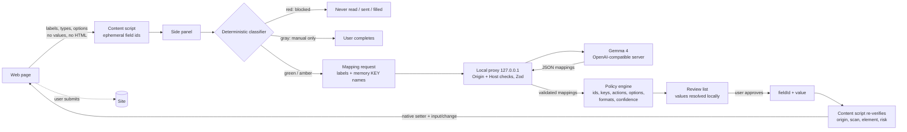

# ContextFill AI

**Your context. Any form. One click.**

ContextFill AI is a privacy-first Chrome extension that fills unfamiliar web forms and document templates from a personal memory you approve. Gemma 4 understands what each field is asking and maps it to the right memory attribute; your values are resolved on your device, every sensitive field needs your approval, and credentials are never touched. You always review and submit yourself.

It is not an autonomous browser agent. It never submits, pays, logs in, clicks buttons or agrees to anything.

---

## What works (verified)

| Area | Status | How it was verified |
| --- | --- | --- |
| MV3 extension (side panel, background, on-demand content script) | Working | Production build; loaded in Chromium 1243 via Playwright |
| Onboarding + memory (add / edit / delete / permissions / provenance) | Working | Real-browser run + unit tests |
| Encrypted vault for private facts (PBKDF2 + AES-GCM) | Working | Unit tests (round trip, wrong passphrase, no plaintext at rest, fresh IV) |
| Form scanning (labels, aria, legends, selects, radio/checkbox groups, open shadow DOM, dynamic fields) | Working | jsdom tests + real-browser run on the demo pages |
| Deterministic risk classification (red/amber/gray/green) before any AI call | Working | 50+ unit tests, adversarial demo page |
| Gemma 4 mapping through local proxy (OpenAI-compatible) | **Implemented; not run against Gemma 4 weights on this machine** | Protocol verified against a fake upstream (tests) and a real local OpenAI-compatible server running a non-Gemma model. See "Connecting Gemma 4" |
| Mock mode (deterministic rules, clearly labelled) and rule-based fallback | Working | Tests + real-browser run |
| Review / approval workflow, editable values, overwrite protection | Working | Real-browser run + tests |
| Safe autofill (native setters, input/change events, React controlled inputs, selects, radios, checkbox groups) | Working | React 19 test in jsdom + page event handlers in Chromium |
| Missing-information flow with Use once / Save to memory (+ extra confirmation for sensitive facts) | Working | Real-browser run (Scene 3) + tests |
| AI drafts for open-ended questions (consent per fact, review required) | Working with Gemma proxy or mock template | Tests; Gemma path depends on your server |
| DOCX `{{placeholder}}` filling (docxtemplater) | Working | Tests on `demo/example-template.docx` |
| Fillable PDF (AcroForm text, dropdown, radio) with pdf-lib | Working | Tests on `demo/example-fillable.pdf` |
| Activity counts (no values) | Working | Real-browser run |

Not supported (by design or not yet): iframes, closed shadow roots, contenteditable / div-based custom widgets, multi-select lists, scanned or encrypted PDFs, PDF checkboxes and signatures, arbitrary blank lines in Word documents.

---

## Architecture

```
contextfill-ai/
  apps/
    extension/            Chrome MV3 extension (TypeScript, React 19, Vite 8, Tailwind 4)
      public/manifest.json
      src/background/     service worker: toolbar action -> side panel
      src/content/        on-demand content script: scan (dom.ts, scanner.ts) + safe fill (filler.ts)
      src/sidepanel/      Autofill, My Memory, Documents, Privacy, Activity, Onboarding
      src/components/     UI primitives, review rows, review list
      src/hooks/          app state (memory, vault, settings, AI engine), proposal pipeline
      src/services/       AI providers (Gemma via proxy, Mock), tab messaging / permissions
      src/memory/         fact validation, MemoryStore, AES-GCM vault
      src/documents/      DOCX (docxtemplater + PizZip) and PDF (pdf-lib), local only
      src/lib/            storage, settings, activity counters
    server/               Express 5 Gemma proxy (localhost only)
      src/gemmaClient.ts  OpenAI-compatible /chat/completions client
      src/routes/ai.ts    /api/health, /api/map, /api/draft
  packages/shared/        types, Zod schemas, classifier, secret detector, catalog,
                          semantic matcher, policy engine, Gemma prompt templates
  demo/                   registration, job application, adversarial form, DOCX, PDF
  tests/                  Vitest (node + jsdom)
  scripts/                demo server, icon + demo document generators
```

### Form-filling data flow



If the proxy or model is unavailable, the same pipeline runs with the deterministic matcher and the UI says "Gemma unavailable: rule-based fallback". Mock mode uses the same rules and is labelled **MOCK MODE** everywhere.

---

## Quick start

Requirements: Node.js 20.12+ (tested with 22.16), npm 10+, Chrome 116+.

```bash
npm install
npm run build          # icons + extension -> apps/extension/dist
npm run demo           # demo forms at http://localhost:5174
```

### Load the unpacked extension

1. Open `chrome://extensions`.
2. Turn on **Developer mode** (top right).
3. Click **Load unpacked** and select `apps/extension/dist`.
4. Pin ContextFill AI and click its icon (or press `Alt+Shift+F`). The side panel opens.
5. Complete onboarding (or click **Use demo profile** for fictional sample data).

The first time you scan a site, Chrome may need your permission for that site: click **Allow on <site>** in the side panel. Access is limited to that one site.

### Mock mode (no model needed)

Privacy tab -> AI engine -> **Mock mode**. Mapping uses deterministic keyword rules and drafts use a local template. Every screen shows **MOCK MODE**; nothing is presented as AI.

### Start the Gemma proxy

```bash
cp .env.example .env   # then set GEMMA_BASE_URL and GEMMA_MODEL
npm run start:server   # http://127.0.0.1:8787  (npm run dev:server for watch mode)
curl http://127.0.0.1:8787/api/health
curl "http://127.0.0.1:8787/api/health?probe=1"   # also asks the upstream /models
```

In the extension: Privacy -> **Gemma 4 via local proxy** -> **Test**. The header badge shows **Gemma 4** only when the proxy reports a configured model.

---

## Connecting Gemma 4 (E4B)

The proxy talks to any server that implements the OpenAI-compatible `POST {GEMMA_BASE_URL}/chat/completions` API. Set the variables to match your server exactly; nothing is guessed.

Verified on Hugging Face (2026-10-16):

- `google/gemma-4-E4B-it`: instruction-tuned Gemma 4 E4B (Apache-2.0, transformers).
- `google/gemma-4-E4B-it-qat-q4_0-gguf`: official 4-bit GGUF for llama.cpp-based runtimes.
- The Hugging Face Inference Providers mapping for `google/gemma-4-E4B-it` was **empty** on that date, so the serverless router could not serve it. Use a local runtime or a dedicated Inference Endpoint.

Pick one runtime:

| Runtime | Start it | `.env` |
| --- | --- | --- |
| llama.cpp | `llama-server -hf google/gemma-4-E4B-it-qat-q4_0-gguf --port 8080` | `GEMMA_BASE_URL=http://127.0.0.1:8080/v1`<br/>`GEMMA_MODEL=google/gemma-4-E4B-it` |
| Ollama | `ollama pull hf.co/google/gemma-4-E4B-it-qat-q4_0-gguf` | `GEMMA_BASE_URL=http://127.0.0.1:11434/v1`<br/>`GEMMA_MODEL=hf.co/google/gemma-4-E4B-it-qat-q4_0-gguf` |
| vLLM | `vllm serve google/gemma-4-E4B-it` | `GEMMA_BASE_URL=http://127.0.0.1:8000/v1`<br/>`GEMMA_MODEL=google/gemma-4-E4B-it` |
| HF Inference Endpoint (dedicated) | Deploy `google/gemma-4-E4B-it` with an OpenAI-compatible container | `GEMMA_BASE_URL=<endpoint url>/v1`<br/>`GEMMA_MODEL=<model name shown by the endpoint>`<br/>`GEMMA_API_KEY=<your HF token>` |

Notes:

- Your runtime version must support the Gemma 4 architecture. Check with `curl $GEMMA_BASE_URL/models` and use the id it lists.
- If the server rejects `response_format`, the proxy retries without it. If it rejects the `system` role, set `GEMMA_MERGE_SYSTEM_PROMPT=true`.
- CPU inference of an 8B-class model can take a minute per scan; `GEMMA_TIMEOUT_MS` defaults to 90 s.
- Set `ALLOWED_ORIGINS=chrome-extension://<your extension id>` (shown on `chrome://extensions`) once the extension is loaded.

The prompt template (`packages/shared/src/ai/prompt.ts`) wraps page text in `<untrusted_form_data>`, sends only memory **key names and descriptions**, forbids selectors/code/values and requires a strict JSON schema that both the proxy and the extension validate.

---

## Using your memory

- **My Memory -> Add a fact.** Choose a built-in attribute (name, college, degree, graduation year, skills, GitHub, ...) or a custom one, enter the value and a permission: *Use automatically*, *Ask every time* or *Never use*.
- Private attributes (phone, city, birth date, GPA, or custom ones that classify as sensitive) are stored only in the **encrypted vault**. Create it in Privacy with a passphrase of 10+ characters. Losing the passphrase means losing the vault.
- Credentials, card numbers, OTPs, API keys and other secrets are refused at save time, whatever the label says.
- Each fact shows where it came from (manual, onboarding, a form's domain, a document) and when.
- Nothing is ever learned from websites unless you click **Save to memory**.

## Demo pages

`npm run demo`, then open <http://localhost:5174>:

| Page | Shows |
| --- | --- |
| `registration.html` | Name, college, email, GitHub, skills, essay, missing graduation year, a "Team Name" field that must not map, a Code of Conduct checkbox. The "Live form state" box proves the site's own event handlers saw the values. |
| `job-application.html` | Different wording ("Applicant Name", "Developer Repository", "Educational Institution"), dropdowns, radios, checkbox group, a field inside an open shadow root, a field added after load, stipend and phone (approval), cover letter (draft). |
| `adversarial-form.html` | Password, disguised passcode, OTP, card number, CVV, expiry, API key, recovery code, a prompt-injection label, hidden honeypots, and a payment authorization checkbox. |
| `example-template.docx`, `example-fillable.pdf` | Document filling (Documents tab). Regenerate with `npm run demo:docs`. |

## 60-second judges' demo

1. **(0-15 s) Scene 1.** Open `registration.html`, open ContextFill, click **Scan Form**. Point at the counts: ready, approval, blocked. "Gemma 4 mapped these from my memory; values never left my laptop." Tick Email (amber), click **Fill approved fields**. The Live form state updates.
2. **(15-30 s) Scene 3.** "Expected Graduation Year" shows *Missing information*. Type 2028, click **Save to memory**. Fill.
3. **(30-45 s) Scene 2.** Open `job-application.html`, **Scan Form**. "Developer Repository" -> GitHub, "Educational Institution" -> college, "Year of Passing" picks 2028 from the dropdown: the fact saved a moment ago. Fill. The cover letter offers **Draft with Gemma 4** with a per-fact consent list.
4. **(45-60 s) Scene 4.** Open `adversarial-form.html`, **Scan Form**. Nine fields are **Blocked**: password, passcode, OTP, card, CVV, expiry, API key, recovery code, and the label that tries to inject instructions. "These are never read, stored or sent to Gemma. My browser's password manager stays in charge." Fill: only name and GitHub change.
5. *(Optional)* Documents tab: upload `example-template.docx`, approve, download the completed copy.

## Scripts

| Command | What it does |
| --- | --- |
| `npm run build` | Generates icons and builds the extension into `apps/extension/dist` |
| `npm test` | Runs the Vitest suite (129 tests) |
| `npm run typecheck` | Type-checks shared, extension, server and tests |
| `npm run verify` | typecheck + tests + build |
| `npm run start:server` / `npm run dev:server` | Gemma proxy |
| `npm run demo` | Demo form server on port 5174 |
| `npm run demo:docs` | Regenerates the demo DOCX and PDF |

## Tests

`tests/` covers: semantic matching, risk classification (password, OTP, card, CVV, API/private keys), name/email/college mapping, dropdown and checkbox-group mapping, React controlled inputs, missing-memory behaviour, no silent memory writes, consent and extra confirmation for sensitive facts, vault encryption, rejection of forbidden model actions, invalid field ids and hallucinated memory keys, overwrite protection, fields that become sensitive or disappear between scan and fill, prompt-injection labels, mixed ordinary/sensitive forms, blocked-value non-reading, proxy origin/host/size checks, the OpenAI-compatible wire format, and inference-unavailable fallback.

## Privacy summary

See [SECURITY.md](SECURITY.md) for the full threat model. In short: classification happens locally before any AI call; only labels and memory key names go to Gemma; values are resolved locally; red fields are never read; private facts are encrypted; the proxy is local and origin-restricted; nothing is submitted for you.
